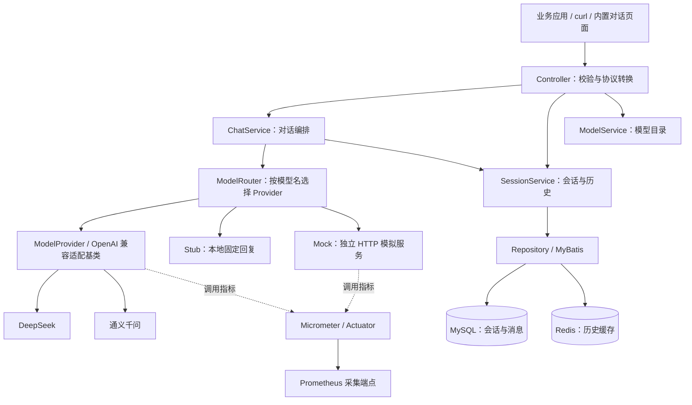

# AI Gateway

面向大语言模型的轻量 Java 网关，以 OpenAI 风格的接口统一接入 DeepSeek、通义千问等模型服务，提供流式对话、会话持久化、服务端上下文和调用监控。

**当前进展：核心对话链路已打通，正在推进多实例限流与模型熔断，后续扩展访问控制、配额与成本治理。**

技术栈：Java 25 · Spring Boot 4.1.1 · WebFlux / Reactor · MyBatis · MySQL · Redis · Micrometer / Prometheus · Docker Compose

## 项目介绍

应用直接对接不同模型服务时，往往需要分别处理接口适配、流式响应、历史消息和监控。AI Gateway 将这些公共能力集中到网关层，让业务应用通过统一入口选择模型、发起对话和管理会话。

- **统一模型接入**：通过 `ModelProvider` 适配不同供应商，调用方使用统一的请求与响应结构。
- **集中管理对话**：保存用户消息与助手回复，支持客户端自带上下文，也支持网关读取历史完成多轮续聊。
- **观察调用质量**：分别统计接口与下游模型的耗时、结果和在途数，支持分析流式首帧延迟。
- **降低联调成本**：提供本地 Stub 和独立 HTTP Mock 接入，不依赖真实模型即可验证部分调用链路。

适用于 AI 助手、聊天应用、多模型接入原型，以及需要研究模型网关路由、流式处理、缓存和可观测性的工程实践。

目前主要兼容文本 Chat Completions 的部分协议字段，尚未实现完整 OpenAI API、调用方认证和会话归属隔离，当前更适合自用或受控环境验证。

## 功能状态与 Roadmap

### 已完成

以下能力以 `main` 已合入代码为基线。

| 方向 | 当前能力 |
| --- | --- |
| 对话接口 | `POST /v1/chat/completions`，支持非流式 JSON 和流式 SSE |
| 模型接入 | DeepSeek、通义千问适配；按模型名路由；`GET /v1/models` 返回配置中的模型目录 |
| 会话管理 | 创建会话、列表、历史查询、修改标题、删除会话；通过 `X-Session-Id` 关联对话 |
| 上下文管理 | 默认由客户端提交历史；`context_mode=server` 由服务端加载历史并追加本轮输入 |
| 数据存储 | MySQL 保存会话和消息；Redis 缓存消息历史，写入或删除后失效 |
| 联调工具 | Stub 固定回复、HTTP Mock Provider、内置网页对话页面、OpenAPI 文档 |
| 可观测性 | 健康检查、Prometheus 指标、Provider 结果与耗时、流式首帧耗时、在途调用数 |
| 工程化 | Maven Wrapper、H2 / Mock 测试、GitHub Actions、Docker 多阶段构建与 Compose 部署 |

### 开发中

以下内容已在 [`codex/model-protection`](https://github.com/ilan14/ai-gateway/tree/codex/model-protection) 分支实现，尚未合入 `main`，暂不作为主分支能力。分支中的保护功能默认关闭，仍需继续验证和完善。

| 方向 | 分支实现与待完善内容 |
| --- | --- |
| 多实例限流 | Redis + Lua 原子协调全局、供应商和模型级 RPM / 并发限制 |
| 并发租约 | 请求期间续租，完成、异常或取消后释放；实例退出后依靠租约过期回收 |
| 模型熔断 | 按供应商与模型隔离，支持连续失败 / 窗口失败率触发、冷却和半开探测恢复 |
| 异常治理 | 下游 429 冷却、首帧与帧间空闲超时；保护错误映射为 429 / 503，并处理 SSE 已提交后的错误 |
| 保护验证 | 已补充单元测试和隔离 Redis 验证脚本，后续完善多实例竞争、故障恢复及目标流量验证 |

设计与配置见分支文档：[模型保护与限流](https://github.com/ilan14/ai-gateway/blob/codex/model-protection/docs/模型保护与限流.md)。

### 未来计划

- [ ] **限流熔断完善与合入**：完成多实例与故障场景验证，完善保护指标、配置和部署说明。
- [ ] **认证与会话隔离**：引入网关 API Key、用户 / 项目归属和会话访问校验。
- [ ] **配额管理**：支持用户 / 项目级请求与 Token 额度、周期重置、预估与结算。
- [ ] **接口可靠性**：完善模型解析、参数校验、统一错误协议与上游错误映射。
- [ ] **会话与缓存治理**：分页、上下文预算、同会话并发顺序、Redis 故障降级与缓存一致性。
- [ ] **用量与成本监控**：Token 用量、费用统计、仪表盘与告警。
- [ ] **路由演进**：模型别名、候选优先级、健康过滤与故障转移。
- [ ] **模型能力扩展**：按实际需求增加工具调用、结构化输出、多模态等协议支持。

Roadmap 会随实际使用情况调整。更多现状分析和演进讨论见 [项目状态分析](docs/project-status-analysis.md)；该文档保留复核日期，最新进展以代码和上表为准。

## 架构与请求链路

### 组件架构



上图描述主分支架构；开发分支中的 Redis 限流与熔断尚未包含在内。

### 一次对话如何执行

1. `ChatController` 校验上下文模式，生成或校验会话 ID，并通过响应头 `X-Session-Id` 返回。
2. `ChatService` 选择 Provider、创建或读取会话；服务端上下文模式先读取历史，再拼接本轮输入，保存用户消息。
3. `ModelProvider` 通过 WebClient 调用上游，返回 JSON 或 SSE 数据。
4. 非流式等待助手消息保存后返回；流式边转发边累积首个 choice 的文本，收到 `[DONE]` 后保存助手消息，再向客户端发送结束标志。
5. 消息写入后清除 Redis 历史缓存，后续查询从 MySQL 回填。

### 关键设计取舍

- **分层职责**：Controller 处理轻量校验与结构转换，Service 编排业务，Provider 封装上游协议，Repository 隔离存储访问。
- **响应式 HTTP 与阻塞存储协作**：WebFlux / WebClient 处理 HTTP 和流式传输，MyBatis 与同步 Redis 操作调度到 `boundedElastic`，避免阻塞事件循环。
- **缓存策略**：历史查询采用 cache-aside，Redis 未命中时查询 MySQL，缓存有效期两小时；写入和删除时清除缓存。
- **上下文边界**：`client` 模式使用请求中的 messages；`server` 模式每次只接收一条非空 user 消息。当前保存本轮最后一条 user 和首个 choice 的助手文本，system 指令不会自动保留到后续服务端上下文。
- **流式完整性**：普通对话要求上游返回 `[DONE]`；失败或取消时不保存部分助手回复。Mock 链路直接转发，绕过会话、存储和上述完整性处理。
- **当前路由边界**：按模型名匹配 Provider；未匹配的模型回退 Stub。模型目录来源于配置，不代表上游实时可用性。

## Quick Start

### 1. 准备环境与数据库

需要 Git、支持 `--wait` 的 Docker Compose v2，以及可供容器访问的 MySQL 和 Redis。**仓库的 Compose 只启动网关，不包含 MySQL、Redis 或 Mock 服务。** 镜像内完成 Java 25 构建与运行，宿主机无需安装 JDK。

```sh
git clone https://github.com/ilan14/ai-gateway.git
cd ai-gateway
cp .env.example .env

# 连接已有 MySQL，初始化数据库与表（按实际地址、端口和用户名修改）。
mysql -h 127.0.0.1 -P 3306 -u root -p < src/main/resources/schema.sql
```

应用不会自动执行建表 SQL。Redis 需提前启动并确认网络可达。

### 2. 配置环境变量

编辑 `.env`，保留示例中的 JVM 与日志配置，按环境修改以下变量：

| 变量 | 说明 |
| --- | --- |
| `DB_URL`、`DB_USERNAME`、`DB_PASSWORD` | MySQL 主机、用户名和密码；默认数据库为 `ai_gateway`，端口为 3306 |
| `SPRING_DATASOURCE_URL` | 可选，覆盖完整 JDBC 地址，适用于非默认数据库名或端口 |
| `REDIS_HOST`、`REDIS_PORT`、`REDIS_PASSWORD` | Redis 地址、端口和密码 |
| `DEEP_SEEK_API_KEY`、`QWEN_API_KEY` | 调用对应真实模型时填写；仅验证 Stub 可保留空值 |
| `MOCK_HTTP_SERVER_URL`、`MOCK_HTTP_SERVER_PORT` | 可选，独立 Mock 服务的协议与主机、端口 |
| `APP_BIND_ADDRESS`、`APP_PORT` | 网关发布地址与端口；本机验证建议设为 `127.0.0.1`、`8080` |
| `APP_MEMORY_LIMIT` | 容器内存上限，默认 `1g` |

宿主机服务使用 `.env.example` 中的 `host.docker.internal`；远程服务填写实际主机名。容器里的 `localhost` 指向容器自身。Linux 下还需确认宿主机端口可通过网关地址访问。

模型名称、上游地址和默认模型配置位于 [application.yaml](src/main/resources/application.yaml)。默认模型为 `stub`；真实模型需明确指定已配置的模型名，并提供有效密钥。

### 3. 构建并启动

```sh
mkdir -p logs
# 镜像以 UID/GID 10001 运行，确保挂载目录及已有日志可写。
sudo chown -R 10001:10001 logs
docker compose config --quiet
docker compose up -d --build --wait --wait-timeout 180
docker compose ps
curl --fail http://localhost:8080/actuator/health
```

启动后可访问：

- 对话页面：[http://localhost:8080/](http://localhost:8080/)
- Swagger UI：[http://localhost:8080/swagger-ui.html](http://localhost:8080/swagger-ui.html)
- 模型目录：[http://localhost:8080/v1/models](http://localhost:8080/v1/models)
- 监控指标：[http://localhost:8080/actuator/prometheus](http://localhost:8080/actuator/prometheus)

修改 `APP_PORT` 后相应替换示例端口。日志查看使用 `docker compose logs --tail=100 ai-gateway`，停止使用 `docker compose down`。完整部署与运维说明见 [Docker 部署](docs/docker-deployment.md)。

### 4. 调用示例

**非流式验证**：Stub 固定返回 `ok`，不调用真实模型，但普通对话仍会访问 MySQL / Redis。`-i` 用于查看响应头中的 `X-Session-Id`。

```sh
curl -i http://localhost:8080/v1/chat/completions \
  -H 'Content-Type: application/json' \
  -d '{"model":"stub","messages":[{"role":"user","content":"你好，请介绍一下自己"}],"stream":false}'
```

**流式调用**：配置有效的 `DEEP_SEEK_API_KEY` 后，使用真实模型；也可以将模型改为 `stub` 验证 SSE。

```sh
curl -N http://localhost:8080/v1/chat/completions \
  -H 'Content-Type: application/json' \
  -d '{"model":"deepseek-chat","messages":[{"role":"user","content":"用三句话解释什么是 AI 网关"}],"stream":true}'
```

**服务端上下文续聊**：将上次成功对话返回的会话 ID 填入变量，发送同一模型的下一轮消息。`context_mode` 是网关扩展字段，不会转发给真实 Provider。

```sh
SESSION_ID='替换为响应头中的 X-Session-Id'
curl -i http://localhost:8080/v1/chat/completions \
  -H 'Content-Type: application/json' \
  -H "X-Session-Id: $SESSION_ID" \
  -d '{"model":"stub","context_mode":"server","messages":[{"role":"user","content":"继续刚才的话题"}],"stream":false}'

# 查询该会话及历史消息。
curl "http://localhost:8080/v1/sessions/$SESSION_ID"
```

传入的会话 ID 必须是已存在的规范 UUID；非法格式返回 400，不存在返回 404。省略 `context_mode` 或设为 `client` 时，由客户端提交所需上下文。

### 接口概览

| 方法 | 路径 | 用途 |
| --- | --- | --- |
| POST | `/v1/chat/completions` | 普通 / 流式文本对话 |
| GET | `/v1/models` | 模型目录 |
| GET | `/v1/sessions` | 按最近活跃时间列出会话 |
| GET | `/v1/sessions/{sessionId}` | 会话详情与历史 |
| PUT | `/v1/sessions/{sessionId}/title` | 修改标题，请求体 `{"title":"新标题"}` |
| DELETE | `/v1/sessions/{sessionId}` | 删除会话、消息和缓存 |

## Engineering

### 测试与 CI

现有测试覆盖聊天编排、Controller、会话服务、Provider 指标、Mock Provider 和 MyBatis Mapper；存储测试使用 H2 或 Mock，不写入真实业务数据。

本地开发需要 JDK 25，使用 Maven Wrapper 运行：

```sh
./mvnw --batch-mode --no-transfer-progress clean verify
```

若运行环境禁止 Mockito 动态挂载 Agent，可通过 `-DargLine=-javaagent:<本机 mockito-core JAR 的绝对路径>` 显式加载；已有环境问题与验证记录见 [项目状态分析](docs/project-status-analysis.md#7-本次验证与证据索引)。

[GitHub Actions](.github/workflows/ci.yml) 在非 main 分支推送、以及面向 main 的 PR 上执行相同的 Maven 验证。Docker 镜像构建跳过测试，提交与发布前需独立运行测试。单元测试之外，真实模型与多实例部署效果仍需在对应环境验证。

### 监控与运行

Actuator 提供健康检查与 Prometheus 指标端点，Micrometer 区分接口耗时和下游 Provider 耗时。模型调用指标包含开始 / 结束次数、成功 / 失败 / 取消、在途数、总耗时和流式首帧耗时，支持基于直方图计算 P95 / P99。

流式首帧指上游首条 SSE 数据事件，可能只有角色信息；当前不等同于首次有效文本。指标与 PromQL 示例见 [接口与模型调用监控](docs/模型调用监控.md)。仓库提供采集端点和查询说明，Prometheus / Grafana 服务需自行部署。

### AI 辅助开发

项目使用 Codex 辅助需求分析、方案设计、代码实现和质量验证，按“分析需求 → 确认方案 → 实现与补充测试 → 验证 → 分支提交”的流程迭代。通过 [AGENTS.md](AGENTS.md) 约束分层职责、中文文档、测试隔离和提交规范，结合 Git diff、测试结果及人工评审检查产出。

当前优先围绕明确需求推进小步改动，后续继续完善自动化质量检查与开发流程。

## 设计与实践文档

| 文档 | 内容 |
| --- | --- |
| [项目状态分析](docs/project-status-analysis.md) | 核心链路、实现边界、设计取舍与演进建议 |
| [Docker 部署](docs/docker-deployment.md) | 环境变量、构建缓存、健康检查与日志运维 |
| [接口与模型调用监控](docs/模型调用监控.md) | 指标口径及 PromQL 查询 |
| [Mock Provider](docs/mock-provider.md) | 独立 HTTP Mock 的接入与行为边界 |
| [模型保护与限流（开发分支）](https://github.com/ilan14/ai-gateway/blob/codex/model-protection/docs/模型保护与限流.md) | Redis 多实例限流、并发租约和熔断恢复设计 |
